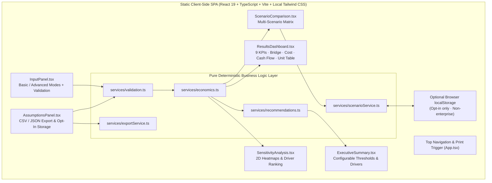
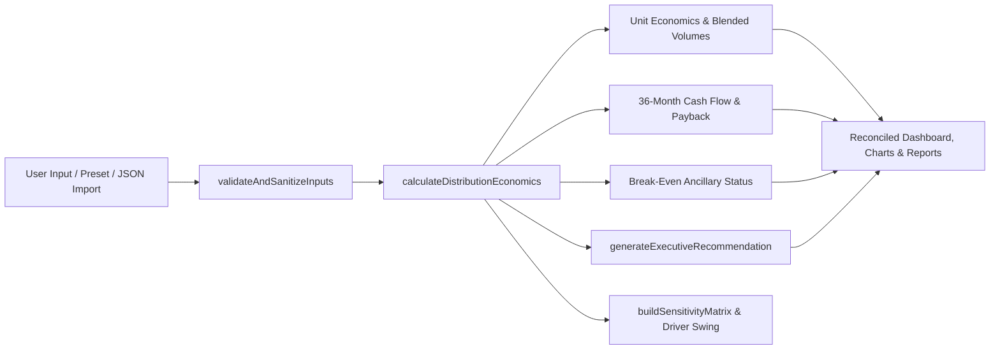
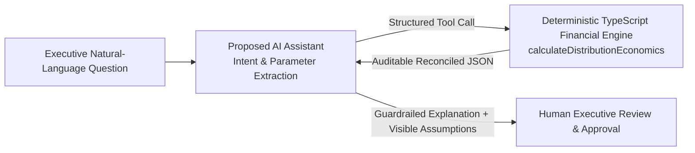

# NDC vs GDS Distribution Decision Assistant (Version 2.0)

An independent airline distribution economics and executive decision-support simulator for comparing legacy Global Distribution System (GDS) commercial arrangements against IATA New Distribution Capability (NDC) scenarios.

---

## 1. Project Overview

The **NDC vs GDS Distribution Decision Assistant (v2.0)** is a browser-based, deterministic financial modeling prototype designed for airline commercial leaders, distribution strategists, revenue management teams, and travel-technology product managers. It evaluates channel strategy across **net GDS distribution cost (including explicit surcharge recovery vs. expense accounting)**, **blended GDS/NDC migration volume**, **Look-to-Book shopping API economics**, **contribution margin vs. gross revenue**, **upfront implementation CAPEX**, **fixed OPEX**, **transition-period overlap**, **cumulative cash-flow payback**, **multi-scenario comparisons**, and **two-way sensitivity analysis**.

> **Prototype & Educational Disclaimer:** This is an independent portfolio and educational decision-support prototype created by Kumar Ravi Shankar ([Curious Kumar](https://curiouskumar.com)). All built-in carrier and regional presets are synthetic illustrative assumptions and do not represent confidential airline contracts, audited forecasts, or certified financial advice.

---

## 2. Business Problem

Airlines migrating indirect volume from legacy EDIFACT GDS workflows toward IATA NDC face a nuanced commercial equation that simple booking-fee comparisons routinely distort:

1. **Surcharge Accounting Confusion:** In several markets, airlines collect a Distribution Technology Charge (DTC / GDS surcharge) on legacy GDS tickets. From the airline's P&L perspective, the retained portion is **revenue recovery** offsetting GDS fees—not an airline expense. Treating it as a cost overstates the savings of leaving legacy GDS.
2. **Gross Revenue vs. Contribution Margin:** Incremental ancillary revenue (seats, bags, bundles) and continuous pricing uplift carry variable fulfilment, payment, and servicing costs. Treating 100% of incremental revenue as profit inflates the NDC business case.
3. **All-or-Nothing Fallacy:** Real airline distribution transitions occur gradually through **blended channels** (e.g., 20%–65% eligible migration) while parallel legacy GDS agreements and servicing teams continue operating.
4. **Hidden Technical & Transition Drags:** High **Look-to-Book (L2B)** shopping API ratios, recurring platform OPEX, upfront implementation CAPEX, and multi-month parallel transition costs can delay or prevent payback even when per-booking fees appear favorable.

---

## 3. Target Users

- **Airline Commercial Executives & VPs of Distribution** framing multi-year channel roadmaps.
- **Distribution Strategy & Agency Relations Leads** modeling GDS surcharge retention, rebates, and NDC aggregator economics.
- **Revenue Management & Airline Retailing Analysts** stress-testing ancillary contribution margins and continuous pricing uplift.
- **Travel-Technology Product Managers & Technical Recruiters** evaluating domain-grounded financial modeling, product trade-offs, and software engineering quality.

---

## 4. Product Value Proposition

- **Commercial Rigor Without Black Boxes:** Every KPI, chart, table row, sensitivity cell, and recommendation reconciles directly to one pure, unit-tested TypeScript financial engine.
- **Zero Cost, Zero Data Leakage:** Runs 100% client-side in the browser—no backend servers, no paid APIs, and no transmission of sensitive scenario inputs to third-party services.
- **Executive Workshop Speed:** Basic and Advanced input modes let executives test directional scenarios immediately while enabling specialists to audit granular fee, L2B, CAPEX, and transition assumptions.

---

## 5. Key Capabilities

- **Explicit GDS Surcharge Treatment:** Toggle between *No surcharge*, *Airline revenue recovery* (with retention %), and *Additional airline expense*—preventing double-counting.
- **Revenue vs. Contribution Margin Separation:** Models signed ancillary and continuous pricing uplifts alongside independent contribution margin percentages.
- **Blended Migration Economics (0%–100%):** Splits eligible monthly bookings into migrated NDC volume and remaining legacy GDS volume.
- **Look-to-Book (L2B) Shopping API Modeling:** Calculates marginal shopping API cost per NDC booking with an explicit toggle and included-request allowance to prevent double-counting.
- **CAPEX, Fixed OPEX & Transition Cash Flow:** Tracks 36-month cumulative cash flow, Year 1 cash flow, exact transition-adjusted payback period (or *"Payback not achieved"*), 3-year cash ROI on CAPEX, and an optional non-double-counted P&L CAPEX allocation view.
- **Redesigned Break-Even Engine:** Classifies break-even ancillary uplift cleanly into *No additional uplift required*, *Exact % uplift required*, *Not achievable*, or *Insufficient data*—never returning `NaN` or `Infinity`.
- **Executive Dashboard:** 9 KPI cards, signed Monthly Financial Contribution Bridge, Blended Distribution Cost breakdown, 36-Month Cumulative Cash Flow chart, and Per-Booking Unit Economics reconciliation table.
- **Multi-Scenario Comparison:** Three built-in templates (*Conservative*, *Balanced / Hybrid*, *Accelerated*) with create, rename, duplicate, independent edit, delete, and reset workflows.
- **Two-Way Sensitivity Analysis & Driver Ranking:** Four interactive sensitivity matrices plus one-at-a-time highest-influence assumption ranking.
- **Explainable Deterministic Recommendations:** Four-state classification (*Favorable*, *Hybrid / Conditional*, *Unfavorable*, *Insufficient Information*) with configurable thresholds, downside sensitivity probe, value drivers, critical risks, and validation checklist.
- **Opt-In Local Persistence & Secure Export:** Optional browser `localStorage` saving, CSV export with formula-injection protection, validated JSON export/import, and print-friendly PDF layout.

---

## 6. Demo & Verification Status

- **Local Demo:** Run `npm ci && npm run dev` and open `http://localhost:3000`.
- **Production Deployment:** Ready for static Vercel deployment (`vercel.json` configured). A live Vercel URL will be linked here only after deployment is executed and verified by the repository owner.

---

## 7. End-to-End Technical Architecture



---

## 8. Data Flow Diagram



---

## 9. Financial Model & Core Formulas

Full worked examples and edge-case specifications are documented in [`docs/FINANCIAL_MODEL.md`](./docs/FINANCIAL_MODEL.md).

> **Important Industry Clarification:** IATA NDC is a data exchange messaging standard, not a single proprietary channel. Major GDS providers also distribute NDC content alongside airline direct APIs and aggregators. For modeling purposes, this simulator compares **Legacy EDIFACT GDS commercial terms** against a **target NDC commercial arrangement**.

### Core Equations (`services/economics.ts`)

| Metric | Formula |
|---|---|
| **Migrated NDC Bookings** | `monthlyBookings * (ndcMigrationPercent / 100)` |
| **Remaining Legacy GDS Bookings** | `monthlyBookings - ndcBookings` |
| **Unit Net GDS Cost** | `(avgSegments * gdsCostPerSegment + gdsAdditionalTransactionFee + surchargeExpense + agencyIncentive + gdsOtherServicingCost) - (surchargeRecovery + commercialRebate)` |
| **Unit Incremental Shopping Cost (L2B)** | `shoppingCostsIncludedInBase ? 0 : max(0, lookToBookRatio * ndcShoppingTrafficShare - includedRequests) * shoppingApiCostPerRequest` |
| **Unit NDC Variable Cost** | `ndcCostPerBooking + unitIncrementalShoppingCost + ndcServicingCostPerBooking` |
| **Unit Incremental Contribution** | `(ATV * ancillaryUplift% * ancillaryMargin%) + (ATV * pricingUplift% * pricingMargin%)` |
| **Variable Distribution Cost Savings** | `(monthlyBookings * unitNetGdsCost) - (remainingGdsBookings * unitNetGdsCost + ndcBookings * unitNdcVariableCost)` |
| **Monthly Steady-State Impact** | `variableDistributionCostSavings + (ndcBookings * unitIncrementalContribution) - incrementalMonthlyFixedOpex` |
| **Monthly Transition-Period Impact** | `monthlySteadyStateImpact - monthlyTransitionExpense` |
| **Cumulative Cash Flow** | Month 0 = `-oneTimeImplementationCapex`; Months 1..T = `monthlyTransitionImpact`; Months (T+1)..36 = `monthlySteadyStateImpact` |

---

## 10. Input & Output Definitions

- **Inputs (29 commercial variables):** Organized into Basic and Advanced modes across 5 groups: Carrier Profile & Blended Volume, Legacy GDS Commercials, NDC Costs & Look-to-Book, Offer Value & Contribution Margins, and CAPEX/OPEX/Transition. Every field defines explicit units, bounds, defaults, and inline explanations.
- **Outputs:** Strict terminology separation across *Gross Incremental Revenue*, *Incremental Contribution Margin*, *Distribution Cost Savings*, *Net Monthly Steady-State Impact*, *Monthly Transition-Period Impact*, *Annualized Steady-State Run Rate*, *First-Year Cash Flow*, *3-Year Cumulative Cash Flow*, *3-Year Cash ROI on CAPEX*, *Implementation Payback Period*, and *Break-Even Ancillary Uplift*.

---

## 11. Product Decisions & Trade-offs

See [`docs/PRODUCT_DECISIONS.md`](./docs/PRODUCT_DECISIONS.md) for the full product rationale. Highlights:

1. **Deterministic Calculation Engine Over LLM Math:** Financial models must be 100% reproducible, auditable, and unit-testable; LLMs are never used to compute financial outputs.
2. **Client-Side Static Architecture:** Eliminates hosting costs, authentication overhead, and confidential data custody risks while keeping latency sub-millisecond.
3. **Basic vs. Advanced Progressive Disclosure:** Balances executive accessibility with commercial specialist depth.
4. **Explicit Separation of Cash Flow vs. Allocated CAPEX:** Prevents double-counting implementation CAPEX across cash payback and P&L views.

---

## 12. Technology Stack

- **Framework:** React `19.x`, TypeScript `5.8`
- **Build Tool:** Vite `6.x` with `@tailwindcss/vite` (Tailwind CSS `4.x` locally compiled—no Play CDN)
- **Bundled Fonts:** `@fontsource/plus-jakarta-sans`, `@fontsource/jetbrains-mono`
- **Visualization & Icons:** Recharts `3.x`, Lucide React
- **Testing & Quality:** Vitest `5.x`, ESLint `10.x` + `typescript-eslint` + `eslint-plugin-react-hooks`
- **CI/CD & Hosting Target:** GitHub Actions (`.github/workflows/ci.yml`), Vercel Static Vite deployment (`vercel.json`)

---

## 13. Repository Structure

```text
├── .github/workflows/ci.yml      # GitHub Actions CI (typecheck, lint, test, build)
├── components/
│   ├── AssumptionsPanel.tsx      # CSV/JSON export, JSON import, print, opt-in local storage
│   ├── ExecutiveSummary.tsx      # Deterministic recommendation & configurable thresholds
│   ├── InputPanel.tsx            # Basic/Advanced assumptions sidebar with tooltips
│   ├── ResultsDashboard.tsx      # 9 KPIs, bridge chart, cost chart, cash flow, unit table
│   ├── ScenarioComparison.tsx    # Multi-scenario templates & side-by-side matrix
│   └── SensitivityAnalysis.tsx   # 4 two-way heatmaps & highest-influence driver ranking
├── docs/
│   ├── ARCHITECTURE.md           # Technical architecture & data-flow documentation
│   ├── DEPLOYMENT.md             # Local, GitHub CI, and Vercel deployment runbook
│   ├── FINANCIAL_MODEL.md        # Plain-English financial formulas & worked examples
│   ├── INTERVIEW_GUIDE.md        # PM interview narrative, 5-min demo, and 30 Q&As
│   └── PRODUCT_DECISIONS.md      # Discovery assumptions, scope, and trade-offs
├── public/                       # favicon.svg, og-preview.svg, robots.txt, sitemap.xml
├── services/
│   ├── economics.ts              # Central financial engine, payback, break-even, sensitivity
│   ├── exportService.ts          # Formula-safe CSV & metadata-rich JSON export
│   ├── recommendations.ts        # Deterministic executive recommendation engine
│   ├── scenarioService.ts        # Scenario CRUD & opt-in localStorage persistence
│   └── validation.ts             # Input bounds, sanity warnings & safe JSON import check
├── tests/                        # Vitest automated unit tests (5 test suites)
├── App.tsx                       # Root application shell & state orchestration
├── constants.ts                  # Synthetic presets, field specs, default scenarios
├── types.ts                      # Domain TypeScript interfaces & enums
├── CHANGELOG.md                  # v1.0 -> v2.0 model and feature changes
├── vercel.json                   # Vercel static build & security response headers
└── vite.config.ts                # Vite + Tailwind + Vitest configuration
```

---

## 14. Local Installation & Execution

**Prerequisites:** Node.js `>= 20.0.0` LTS and npm.

```bash
# 1. Clone repository
git clone https://github.com/krshankar14/ndc-vs-gds-cost-analyzer-public.git
cd ndc-vs-gds-cost-analyzer-public

# 2. Install dependencies reproducibly
npm ci

# 3. Start local development server (http://localhost:3000)
npm run dev
```

No environment variables or API keys are required (see `.env.example`).

---

## 15. Testing & Quality Commands

```bash
npm run typecheck   # Strict TypeScript compilation check
npm run lint        # ESLint check across TypeScript and React components
npm test            # Run full Vitest automated test suite (5 suites)
npm run build       # Build production static bundle to dist/
npm run preview     # Preview production build locally
```

---

## 16. GitHub Continuous Integration

`.github/workflows/ci.yml` runs on pushes to `main` / `feature/**` and pull requests targeting `main` with read-only `contents: read` permissions:

1. `npm ci` (Node.js 20 LTS)
2. `npm run typecheck`
3. `npm run lint`
4. `npm test`
5. `npm run build`

---

## 17. Vercel Deployment

Full instructions are provided in [`docs/DEPLOYMENT.md`](./docs/DEPLOYMENT.md).

- **Framework Preset:** Vite
- **Install Command:** `npm ci`
- **Build Command:** `npm run build`
- **Output Directory:** `dist`
- **Production Branch:** `main`
- **Environment Variables:** None required
- **Security Headers:** Configured in `vercel.json` (`X-Content-Type-Options`, `Referrer-Policy`, `X-Frame-Options`, `Permissions-Policy`, and a self-hosted `Content-Security-Policy`).

---

## 18. Security & Privacy Considerations

- **No Secrets / Zero Telemetry:** No external API keys, analytics beacons, or third-party data transmissions.
- **CSV Formula Injection Defense:** String cells beginning with `=`, `+`, `-`, `@`, `\t`, or `\r` are prefixed with `'` before RFC-4180 quoting in `services/exportService.ts`.
- **Strict JSON Import Validation:** Imported JSON files are size-capped (250 KB), scanned for prototype-pollution keys (`__proto__`, `constructor`, `prototype`), and validated against explicit schema bounds before loading.
- **Opt-In Local Storage:** Browser persistence is disabled by default and clearly disclosed as non-enterprise local storage.

---

## 19. Authoritative References vs. Synthetic Assumptions

- **External Industry Concepts (Authoritative Sources):**
  - [IATA — New Distribution Capability (NDC)](https://www.iata.org/en/programs/airline-distribution/retailing/ndc/) — definition of NDC as an XML/JSON offer-and-order data exchange standard.
  - [IATA — Dynamic Offers & Continuous Pricing](https://www.iata.org/en/programs/airline-distribution/retailing/dynamic-offers/) — background on moving beyond static 26-class RBD fare filing.
  - [IATA — Airline Retailing Maturity (ARM) Index](https://www.iata.org/en/programs/airline-distribution/retailing/) — industry context on airline retailing and servicing maturity.
- **Synthetic Demonstration Assumptions (Not Verified Commercial Benchmarks):**
  - All default FSC, LCC, and regional preset numbers in `constants.ts` (segment fees, surcharge amounts, retention %, L2B ratios, ancillary uplift %, CAPEX/OPEX) are illustrative synthetic figures created solely for educational modeling.

---

## 20. Proposed Future AI Capabilities (Not Implemented in v2.0)

Version 2.0 intentionally uses **zero runtime AI or LLMs**. A proposed future Version 3.0 architecture would preserve deterministic financial math while adding an optional conversational explanation layer:



Key proposed guardrails: (1) the LLM never computes arithmetic directly—all numbers come strictly from the deterministic tool; (2) all modified assumptions stay visibly displayed; (3) unsupported ROI/forecast claims are blocked; (4) human approval is mandatory for any business decision.

---

## 21. Product Roadmap

1. Multi-year phased migration ramp curves (e.g., Year 1 15% → Year 2 35% → Year 3 60% instead of step-change migration).
2. Point-of-sale and agency-segment weighting (Corporate TMC vs. Leisure OTA vs. Traditional Retail).
3. Multi-currency modeling (USD / EUR / GBP / INR) with explicit FX assumptions.
4. Optional tool-calling AI narrative assistant (strictly backed by the deterministic engine).

---

## 22. Author Information

Created by **Kumar Ravi Shankar** (**Curious Kumar**) — [curiouskumar.com](https://curiouskumar.com) · [github.com/krshankar14](https://github.com/krshankar14).

*Transparency note: Product framing, airline distribution domain requirements, commercial model corrections, and acceptance criteria were directed by the project owner, with AI-assisted software engineering used during prototyping, implementation, and test automation.*

---

## 23. License

Released under the [MIT License](./LICENSE).
