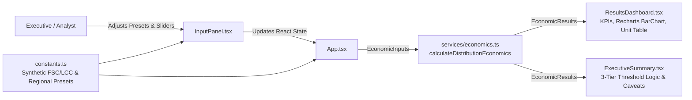

# NDC vs GDS Distribution Decision Assistant

## Project Overview

The **NDC vs GDS Distribution Decision Assistant** is an interactive, client-side financial modeling prototype built for airline commercial and distribution leaders. It compares legacy Global Distribution System (GDS) channel economics against IATA New Distribution Capability (NDC) scenarios by evaluating both **Total Cost of Distribution (TCD)** and **Total Value of Offer (TVO)**. Users can test carrier profiles, regional GDS surcharge regimes, NDC technology costs, and ancillary revenue assumptions to see unit economics, monthly financial impact, break-even ancillary uplift, and a rule-based strategic recommendation.

---

## Business Problem

Airlines evaluating a transition from legacy GDS indirect distribution to IATA NDC often struggle to frame the commercial case beyond headline booking fees:

- **Cost-only comparisons are incomplete:** Legacy GDS channels incur per-segment booking fees and, in several regions, Distribution Technology Charges (DTC / GDS surcharges), whereas NDC introduces aggregation, middleware, and API servicing costs per booking.
- **Value creation is uneven across carrier models:** Full-Service Carriers (FSCs) with higher average ticket values, multi-segment itineraries, and richer ancillary catalogs face very different channel trade-offs than point-to-point Low-Cost Carriers (LCCs).
- **Target users:** Airline commercial executives, distribution strategy leads, revenue management analysts, and travel-technology product managers who need a transparent directional simulator for early-stage channel strategy discussions.

---

## Product Objective

Provide a fast, self-contained executive scenario simulator that:

1. Quantifies monthly and per-booking distribution cost differences between GDS and NDC channels.
2. Incorporates incremental offer value (ancillary uplift and continuous pricing uplift) alongside direct distribution fees.
3. Calculates the **break-even ancillary uplift percentage** required for NDC to match or outperform the GDS baseline.
4. Translates the resulting net financial delta into a clear, caveated directional posture (**Favorable**, **Hybrid**, or **Unfavorable**).

---

## My Role

- **Verified individual prototype authorship:** The application code and UI attribution identify **Kumar Ravi Shankar** as the builder of this standalone prototype, covering problem framing, airline distribution domain modeling (TCD vs. TVO formulas and FSC/LCC/regional presets), UI/UX layout, and front-end TypeScript/React implementation.
- **Scope boundary:** Because this repository represents an independent working prototype without an accompanying corporate production history, no claims are made regarding enterprise deployment, team size, or commercial P&L realization at any specific airline.

---

## Key Features

All capabilities listed below are verified in the current implementation:

- **Carrier Profile Presets (`FSC` and `LCC`):** One-click switching between illustrative Full-Service Carrier and Low-Cost Carrier default profiles, plus a Reset button to restore active profile defaults.
- **Regional GDS Commercial Presets (`NA`, `EU`, `APAC`):** Quick-apply buttons updating GDS cost per segment and GDS surcharge (DTC) levels to reflect generalized regional market patterns.
- **Interactive Scenario Controls:**
  - Numeric inputs for Monthly Indirect Bookings and Average Segments per Booking (bounded at non-negative values).
  - Selectors for GDS Cost per Segment (`$4.00`, `$6.00`, `$8.00`) and GDS Surcharge per Booking (`$0`, `$15`, `$18`, `$21`, `$25`).
  - Range sliders for Estimated NDC Cost per Booking (`$1.00`–`$15.00` in `$0.50` increments) and Ancillary Uplift Assumption (`0.0%`–`15.0%` in `0.5%` increments).
  - Read-only display of Continuous Pricing Uplift (`+1.5%` for FSC, `+0.5%` for LCC).
- **Executive KPI Dashboard & Visual Comparison:**
  - Monthly KPI summary cards for Current GDS TCD, Projected NDC Value, and Net Financial Impact (Profit Accretive vs. Cost Dilutive).
  - Stacked bar chart (`Recharts`) comparing GDS Baseline vs. NDC Scenario across Distribution Cost and Revenue Uplift.
  - Per-booking Unit Economics table showing Tech & Segment Fees, Value Creation, Net Economic Position, and Break-even Ancillary Uplift Required.
- **Rule-Based Executive Recommendation & Mandatory Caveats:**
  - Categorizes scenarios into Favorable (`> +10%`), Hybrid (`-10%` to `+10%`), or Unfavorable (`< -10%`) relative to the GDS baseline.
  - Permanently surfaces four modeling caveats (directional nature, 12–18 month transition overlap, exclusion of Look-to-Book shopping traffic costs, and Agency/TMC readiness dependency).

---

## Solution Architecture

The application is a purely client-side React single-page application (SPA) with zero external runtime APIs, no backend server, and no database persistence. All calculations execute synchronously via React `useMemo` whenever input state changes.



### Verified Economic Formulas (`services/economics.ts`)

| Metric | Formula |
|---|---|
| **Unit GDS Cost** | `(avgSegments * gdsCostPerSegment) + gdsSurcharge` |
| **GDS Monthly Cost** | `monthlyBookings * unitGDSCost` |
| **NDC Monthly Cost** | `monthlyBookings * ndcCostPerBooking` |
| **Unit Ancillary Lift** | `avgTicketValue * (ancillaryUpliftPercent / 100)` |
| **Unit Continuous Pricing Lift** | `avgTicketValue * (continuousPricingUpliftPercent / 100)` |
| **Total NDC Value (Monthly)** | `monthlyBookings * (unitAncillaryLift + unitPricingLift)` |
| **Net Financial Delta (Monthly)** | `(gdsMonthlyCost - ndcMonthlyCost) + totalNDCValueMonthly` |
| **Net Impact % (vs. GDS Baseline)** | `(netDeltaMonthly / gdsMonthlyCost) * 100` (guarded when GDS cost is `0`) |
| **Break-Even Ancillary Uplift %** | `((unitNDCCost - unitGDSCost - unitPricingLift) / avgTicketValue) * 100` |

---

## Product Decisions and Trade-offs

1. **TCD + TVO Framing Over Pure Cost Comparison:** Rather than modeling NDC solely as a fee-reduction initiative, the simulator pairs cost deltas with ancillary and continuous pricing uplift so decision-makers can test whether commercial value offsets higher aggregation/servicing costs.
2. **Client-Side Deterministic Engine vs. Backend Persistence:** Keeping all math in a stateless TypeScript module ensures sub-millisecond responsiveness, zero hosting/API cost, and no handling of confidential airline data—trading off multi-scenario saving, user accounts, and collaborative sharing.
3. **Curated Presets & Bounded Controls vs. Full P&L Complexity:** Exposing core commercial levers (bookings, segments, GDS fees/surcharges, NDC cost, ancillary uplift) while fixing secondary assumptions (`avgTicketValue`, `continuousPricingUpliftPercent` per carrier profile) reduces cognitive load for executive workshops. The trade-off is that Look-to-Book (L2B) shopping costs, agency incentive contracts, payment processing deltas, and IT implementation CAPEX are intentionally out of scope and flagged as caveats.
4. **Transparent Assumption Boundaries:** The `ancillaryMargin` field (`$30` FSC / `$20` LCC) is retained as a reference benchmark in the data model for future gross-margin P&L extensions and is explicitly labeled as not applied to the top-line revenue uplift formula.

---

## AI Capabilities

**No runtime AI or LLM capabilities are implemented in this application.**

- There are no LLM SDKs, prompts, external model calls, or agent workflows in the codebase.
- All executive recommendations in `components/ExecutiveSummary.tsx` are generated by deterministic threshold rules (`netDeltaPercent > 10%`, `-10%` to `+10%`, `< -10%`).
- If AI coding tools were used during initial prototyping, they played a development-time role only and are not part of the application's runtime architecture.

---

## Demonstrated Results

To maintain strict evidence standards, outcomes are separated by verification level:

- **Achieved outcomes (verified locally):**
  - Clean TypeScript compilation (`tsc --noEmit`) and production bundle generation (`vite build`).
  - Verified deterministic arithmetic and edge-case safety (including zero-booking and negative-input handling) via automated unit assertions in `services/economics.test.ts`.
  - Zero known dependency vulnerabilities reported by `bun audit` across 158 resolved packages.
- **Observed prototype behaviour (using synthetic defaults):**
  - Under the default synthetic **FSC** profile (`100,000` monthly bookings, `2.6` avg segments, `$6/seg` GDS fee, `$18` GDS surcharge, `$4.50` NDC cost, `4.0%` ancillary uplift, `1.5%` continuous pricing uplift on `$300` average ticket), the model computes `$3,360,000/mo` GDS TCD (`$33.60/booking`), `$450,000/mo` NDC cost, `$1,650,000/mo` incremental NDC value, and a `+$4,560,000/mo` (`+135.7%`) net delta (**Favorable**).
  - Under a high-cost **LCC** stress test (`$15.00` NDC cost, `0%` ancillary uplift, `$0` GDS surcharge, `$7.20` unit GDS cost), the model flags **Unfavorable** and calculates a `6.00%` break-even ancillary uplift threshold.
- **Expected benefits (directional):**
  - Faster alignment between commercial, distribution, and IT stakeholders during early NDC business-case workshops.
- **Hypotheses awaiting validation:**
  - Real-world airline commercial impact requires replacing synthetic benchmarks with carrier-specific GDS contract schedules, agency incentive tiers, L2B shopping ratios, and empirical NDC ancillary conversion rates.

---

## Technology Stack

Only verified dependencies present in `package.json` and `index.html`:

- **UI Framework:** React `^19.2.3`, React DOM `^19.2.3`
- **Language:** TypeScript `~5.8.2`
- **Build Tool & Dev Server:** Vite `^6.2.0` (`@vitejs/plugin-react` `^5.0.0`)
- **Data Visualization:** Recharts `^3.6.0`
- **Icons:** Lucide React `^0.562.0`
- **Styling:** Tailwind CSS (loaded via Play CDN in `index.html`) and Inter typography (Google Fonts)

---

## Installation and Demo

### Prerequisites

- Node.js 18+ (or Bun 1.x) and npm

### Local Setup

```bash
# 1. Install dependencies
npm install

# 2. (Optional) Review .env.example — no API keys or secrets are required

# 3. Start the local development server on http://localhost:3000
npm run dev
```

### Verification Commands

```bash
# Type-check with TypeScript
npm run typecheck

# Build production bundle
npm run build
```

All default inputs use synthetic illustrative benchmarks (`constants.ts`)—no external accounts, credentials, or proprietary datasets are needed to run the demo.

---

## Limitations and Roadmap

### Current Limitations

- **Simplified financial scope:** Excludes Look-to-Book (L2B) shopping API costs, GDS/agency incentive rebates, servicing/re-accommodation operational costs, and one-time NDC implementation CAPEX.
- **Fixed secondary assumptions in UI:** Average Ticket Value and Continuous Pricing Uplift change via carrier profile presets (`FSC`/`LCC`) but are not directly editable in the sidebar.
- **Single-scenario view:** No side-by-side scenario comparison, CSV/PDF export, or saved state across page reloads.
- **Styling delivery:** Uses Tailwind Play CDN (`cdn.tailwindcss.com`) for rapid prototyping rather than a compiled local Tailwind CSS bundle.

### Proposed Roadmap

1. Expose editable controls for Average Ticket Value, Continuous Pricing Uplift, and Look-to-Book shopping cost assumptions.
2. Add side-by-side multi-scenario comparison and sensitivity heatmaps (e.g., NDC Cost vs. Ancillary Uplift).
3. Migrate from Tailwind Play CDN to a compiled local Tailwind CSS pipeline for production readiness.
4. Add URL-encoded shareable scenario links and CSV/JSON export for executive decks.

---

## Disclaimer

This repository is an **independent educational and executive decision-support prototype**. All carrier profiles, regional presets, and commercial figures are synthetic illustrative benchmarks and do not represent confidential pricing, contract terms, or financial forecasts for any airline, GDS, or aggregator. Outputs are directional only and should not be used as audited financial or P&L guidance.

---

## License

Released under the [MIT License](./LICENSE).
