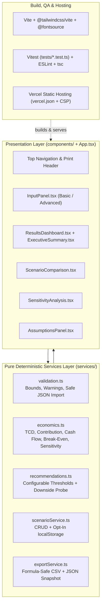
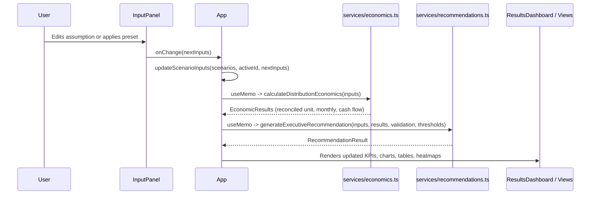
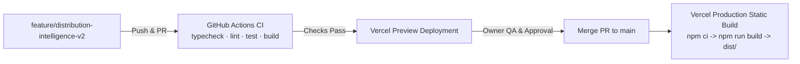

# Solution & Technical Architecture (Version 2.0)

## 1. Architectural Overview

The **NDC vs GDS Distribution Decision Assistant** is a stateless, client-side Single-Page Application (SPA) built with **React 19**, **TypeScript 5.8**, **Vite 6**, and locally compiled **Tailwind CSS 4**. There is no backend server, no database, no user authentication system, and no runtime AI/LLM API dependency.

---

## 2. Application Layers & Key Files

| Layer | Files | Responsibility |
|---|---|---|
| **Entry & Styling** | `index.html`, `index.tsx`, `index.css` | SEO/OpenGraph/JSON-LD metadata, local `@fontsource` imports, compiled Tailwind CSS v4, print stylesheet. |
| **State Orchestration** | `App.tsx` | Holds active tab, scenarios array, active scenario ID, recommendation thresholds, and opt-in persistence flag; computes memoized validation, economics, and recommendation outputs. |
| **Domain Contracts** | `types.ts`, `constants.ts` | Strongly typed interfaces/enums, synthetic carrier and illustrative regional presets, 29 field specs (min/max/step/unit/tooltip), and 3 default scenario templates. |
| **Calculation Engine** | `services/economics.ts` | Single source of truth for blended volume splits, GDS net unit cost, L2B shopping costs, contribution margins, 36-month cash flows, payback, break-even, 2D sensitivity matrices, and driver swing rankings. |
| **Validation** | `services/validation.ts` | Finite-number clamping, range errors, commercial sanity warnings, and prototype-pollution-safe JSON import schema validation. |
| **Decision Engine** | `services/recommendations.ts` | Deterministic 4-state posture classification combining steady-state impact, payback, transition cash drag, and an automatic downside stress probe. |
| **Scenario & Export** | `services/scenarioService.ts`, `services/exportService.ts` | Immutable scenario CRUD, opt-in browser `localStorage`, RFC-4180 CSV export with formula-injection defense, and structured JSON export. |
| **UI Components** | `components/*.tsx` | Pure presentational/interactive views with zero duplicated financial formulas. |
| **Automated Tests** | `tests/*.test.ts` | 5 Vitest suites verifying reference calculations, edge cases, recommendations, scenario CRUD, validation, and export security. |

---

## 3. React State Management & Data Flow

- **Single Source of Truth:** Neither `ResultsDashboard`, `ScenarioComparison`, nor `SensitivityAnalysis` duplicates arithmetic; every displayed figure originates from `calculateDistributionEconomics`.
- **Optional Browser Persistence:** `localStorage` is read on boot only when `ndc_gds_v2_persistence_enabled === 'true'`, and written only when the user explicitly opts in or clicks *Save Snapshot Now*.

---

## 4. Security Architecture

- **Zero Server Attack Surface:** No REST endpoints, database queries, cookies, or third-party API calls.
- **No External Runtime CDNs:** Tailwind CSS and web fonts (`Plus Jakarta Sans`, `JetBrains Mono`) are bundled directly into `dist/assets/` at build time.
- **Content Security Policy & Response Headers (`vercel.json`):** Restricts scripts and network connections to `'self'`, blocks framing (`X-Frame-Options: SAMEORIGIN`, `frame-ancestors 'self'`), enforces `X-Content-Type-Options: nosniff`, `Referrer-Policy: strict-origin-when-cross-origin`, and restrictive `Permissions-Policy`.
- **CSV Formula Injection Mitigation:** User-controlled string fields starting with `=`, `+`, `-`, `@`, `\t`, or `\r` are neutralized with a leading `'` before quoting.
- **Safe JSON Import:** Rejects payloads over 250 KB, rejects forbidden keys (`__proto__`, `constructor`, `prototype`), and validates every field against `INPUT_FIELD_SPECS`.

---

## 5. Vercel Deployment Flow

